# Oštro Zvezoskop 2024

  - [Oštro Zvezoskop](https://ostro.si/tag/zvezoskop/)
  - Zvezoskop [SI](https://www.zvezoskop.si/si/) / [EN](https://www.zvezoskop.si/en/)
  - Stories: [Stable right, fragmented left](https://ostro.si/en/stories/stable-right-fragmented-left/)
  - [February 2024](https://github.com/bavla/TQ/blob/master/trajectories/Feb24/README.md)
  - [vlado/wiki](http://vladowiki.fmf.uni-lj.si/doku.php?id=vlado:work:tra:ostro)

## 1-neighbors
 
 
## Sosedi
 

## Izobraževanje
 

## Izobraževanje 3
 

## Izrez
 
